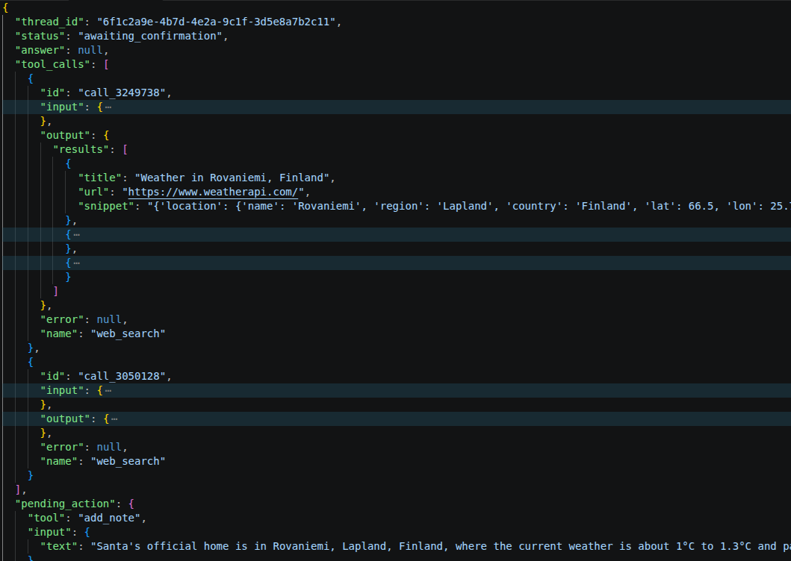
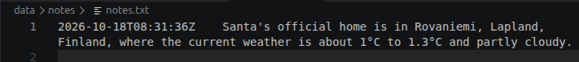
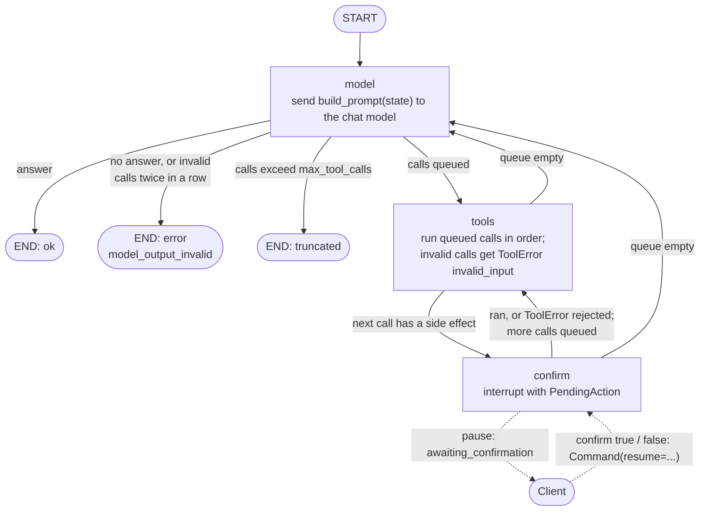

# harnessd


**A reference harness for AI-assisted development:
spec-first workflow, traceable tests, and CI, demonstrated on a FastAPI/LangGraph agent service.**
- AI coding base using Claude, with prompts, rules and workflows and specific details
for Python which include strict typing (mypy), linting and formatting (ruff) and
code coverage (pytest/coverage) rules.
- FastAPI service exposing a single LangGraph agent (with 3 tools) that returns
validated, structured responses. Conversation state is checkpointed in Redis.
- Provider-agnostic, allowing different foundation models, currently supporting Anthropic,
Gemini and local Ollama models.
- Requirements live in `docs/requirements/`; see the
[requirements](docs/requirements/requirements.md) (R-ids, with the specs that meet each one).
- Specs live in `docs/specs/`; see the [spec index](docs/specs/README.md).
- Traceability from each spec behavior to its acceptance tests is generated by
`make trace`; see the [traceability document](docs/traceability.md).

## Example call to harnessd backend
- Run docker compose with `TAVILY_API_KEY` and a model provider set in `.env`
  (see [Setup](#setup)).
- Call the `/v1/agent/run` endpoint with the message
  `"Add a note about the weather at Santa's House."`. You can also do this from the
  OpenAPI docs at <http://localhost:5999/docs>.

```bash
curl -X 'POST' 'http://localhost:5999/v1/agent/run' \
  -H 'accept: application/json' -H 'Content-Type: application/json' \
  -d '{
  "thread_id": "6f1c2a9e-4b7d-4e2a-9c1f-3d5e8a7b2c11",
  "message":  "Add a note about the weather at Santa'\''s House.",
  "max_tool_calls": 5
}'
```

- The agent calls `web_search` twice (where does Santa live? what is the weather
  there?), then asks the user to confirm the `add_note` call. The response has
  `status: "awaiting_confirmation"` and the note in `pending_action`. Some fields are
  collapsed in the screenshot; click it to see it full size.

<a href="docs/images/call_to_add_note_on_weather_at_santas_house.png"></a>

- The user sends a confirmation:

```bash
curl -X 'POST' 'http://localhost:5999/v1/agent/run' \
  -H 'accept: application/json' -H 'Content-Type: application/json' \
  -d '{
  "thread_id": "6f1c2a9e-4b7d-4e2a-9c1f-3d5e8a7b2c11",
  "confirm": true
}'
```

- The note is written and the run finishes with `status: "ok"` and the model's
  answer. The note is recorded in a file (it could be a database later):



- `GET /v1/threads/6f1c2a9e-4b7d-4e2a-9c1f-3d5e8a7b2c11` shows the whole thread: the
  messages, tool calls and results, and any summary.

## How the agent works
The agent is a LangGraph graph with three nodes. The model either answers or asks for
tool calls; read-only tools run straight away, and a side-effecting tool (add_note)
pauses the run until the user confirms or rejects it in the next request. State is
checkpointed in Redis after every step. See the
[design doc](docs/design/design.md#agent-graph) for details.



## Setup

You need [uv](https://docs.astral.sh/uv/) and Docker (for Redis).

```bash
uv sync
cp .env.example .env              # then edit .env, see below
docker compose up -d redis        # Redis 8.2 on localhost:6379
uv run uvicorn app:app --app-dir src --reload --port 5999
```

Open http://localhost:5999/docs to try the API. To run the app in Docker as well,
use `docker compose up -d`. Settings are read at startup, so restart the server
after editing `.env`.

### Model provider
Pick one provider in `.env`:

| Provider | `.env` |
|----------|--------|
| Ollama (local, default) | `LLM_PROVIDER=ollama`, `LLM_MODEL=llama3.1`, `OLLAMA_BASE_URL=http://localhost:11434` |
| Anthropic | `LLM_PROVIDER=anthropic`, `LLM_MODEL=claude-sonnet-5-5`, `ANTHROPIC_API_KEY=...` |
| Google Gemini | `LLM_PROVIDER=google`, `LLM_MODEL=gemini-3.5-flash-lite`, `GOOGLE_API_KEY=...` |

For Ollama:
- If not yet pulled, pull the model first (`ollama pull <model_name>`). It must support tool calls.
- Local models can be slow. If runs time out, raise `RUN_TIMEOUT_SECONDS`
  (e.g. 300).
- When the app runs in Docker, `localhost` is the container, so set
  `OLLAMA_BASE_URL` to the host's address.

### Web search
`web_search` uses [Tavily](https://tavily.com). Set `TAVILY_API_KEY` in `.env`.
Without it the agent still runs, but every search returns an error to the model.

### Logging
`LOG_LEVEL` (`debug`, `info`, `warning`, `error`; default `info`) sets how much the
server logs. At `info` each run logs its start and end, every graph step and every
tool call, tagged with the thread id. Message text and answers are never logged;
`debug` adds tool inputs. Every line written while handling a request carries
`request=` (the `X-Request-ID` header, returned on every response) and, with
tracing on, `trace=`. `LOG_FORMAT=json` writes one JSON object per line instead.

### Tracing (Langfuse)
Tracing is off by default. With it on, each request is one trace: the HTTP request,
the agent run, every model call (prompt, reply, tokens, latency) and every tool call
and confirmation. A thread's traces are grouped as one Langfuse session.

1. `make langfuse` starts Langfuse and its stores (Postgres, ClickHouse, Redis,
   MinIO) under the compose `observability` profile. It needs several GB of RAM.
2. Open http://localhost:5998, sign up (the account is local), create an
   organisation and a project, then create API keys in the project's settings.
3. In `.env` set `TRACING_ENABLED=true`, `LANGFUSE_PUBLIC_KEY` and
   `LANGFUSE_SECRET_KEY`, and restart the server.

Prompts, replies and tool data are recorded on spans; set `TRACE_CONTENT=false` to
keep only names, ids, timings and token counts (do this in shared deployments). To
send traces to another OTLP backend (Phoenix, Jaeger, ...), set
`OTEL_EXPORTER_OTLP_ENDPOINT` and, if needed, `OTEL_EXPORTER_OTLP_HEADERS`. If the
backend is down, requests are unaffected and a `trace.export_failed` warning is
logged at most once a minute.

## Development

Managed with Astral UV:
```bash
uv sync
```

Static Analysis and formatting (run via uv):
```bash
make lint     # lint files with ruff
make fix      # lint files and fix
make format   # format files with ruff
make pytests  # Run pytest on tests
make trace    # check spec traceability, write docs/traceability.md
make langfuse # start a local Langfuse for traces (needs Docker)
```
