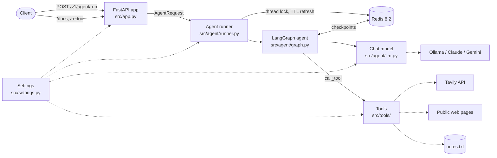
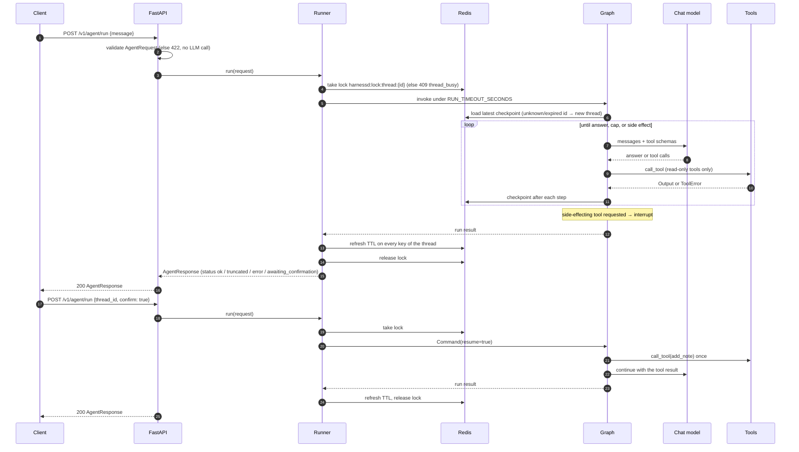

# Design: harnessd agent service

Status: reviewed
Specs: SPEC-0001 Agent core, SPEC-0002 API service, SPEC-0003 Tool contract,
SPEC-0004 State and persistence, SPEC-0005 Test strategy, SPEC-0006 Traceability,
SPEC-0007 API documentation (see [the spec index](../specs/README.md))

This document pulls together how the service is built and why. The specs are the
contract; where this document and a spec disagree, the spec wins and this document
is out of date.

## Problem and constraints
Create an example Claude Code workspace and demonstrate with a FastAPI service that uses an
LLM and tools.

The FastAPI service exposes one LangGraph agent. The agent answers a user message,
calling up to three tools, and every response is a validated, structured
`AgentResponse`. Conversation state lives in Redis so a thread can be continued, or
resumed after a human confirms a side effect.

Constraints:
- **Provider-agnostic model**: Ollama locally, Anthropic Claude or Google Gemini
  hosted, chosen by settings with no code change (SPEC-0001 B-0001).
- **Typed boundaries**: Pydantic v2 models for the API and for every tool's input
  and output; unknown fields are rejected.
- **Bounded runs**: a tool-call cap per request, a time limit per run and per tool,
  and one run per thread at a time.
- **Deterministic CI**: no real LLM or web calls and no API keys; real Redis only
  where persistence is under test (SPEC-0005).
- **Spec-first and traceable**: behavior is specified before it is coded, and tests
  name the spec behaviors they prove (SPEC-0006).
- **Non-goals**: auth, streaming, multi-agent routing, a UI, production deployment.

## Proposed approach
Starting with a basic version, develop and update the CLAUDE.md and other associated
files as the project progresses. Add on to these as new rules are needed.

FastAPI handles HTTP and validation. Each request goes to an agent runner that takes
a per-thread lock in Redis, runs the LangGraph graph against a Redis checkpointer
under a time limit, then refreshes the thread's TTL. The graph alternates between
the chat model and the tools until the model answers, the tool-call cap is reached,
or a side-effecting tool needs confirmation. Tools never raise: every failure comes
back to the model as a `ToolError`.

### Components
Status: **built** = on main; **review** = in an open PR; **planned** = specified, not
yet written.

| Module | Responsibility | Spec | Status |
|--------|----------------|------|--------|
| `src/app.py` | Builds the FastAPI app: Swagger/ReDoc metadata, lifespan (logging, `Services`), error handlers and the routers. | SPEC-0002, SPEC-0007 | built |
| `src/api/agent.py`, `src/api/health.py` | One `APIRouter` per area: `POST /v1/agent/run` (turns `ConfirmationStateError` into 422), `GET /health`. | SPEC-0002 | built |
| `src/api/deps.py` | `Services` builds the Redis client and graph on first use, so the app starts while Redis is down. Dependencies `get_settings` → `get_graph` / `get_guard` → `get_runner`; tests override the graph and guard. | SPEC-0002 | built |
| `src/api/errors.py` | Exception handlers: `ThreadBusyError` → 409, Redis/LLM connection errors and provider refusals → 503, anything else → 500 via `InternalErrorMiddleware`. `error_responses()` documents a route's error codes. | SPEC-0002, SPEC-0007 B-0004, SPEC-0008 B-0005 | built |
| `src/schemas.py` | Pydantic models: AgentRequest/AgentResponse, ErrorInfo, PendingAction, ToolError, each tool's Input/Output, the tool-call trace. | SPEC-0002, SPEC-0003 | built |
| `src/settings.py` | One `Settings` class from env and `.env`; fails at startup if a hosted provider has no key. `get_settings()` is cached for injection. | SPEC-0001, SPEC-0004 | built |
| `src/agent/llm.py` | `build_chat_model()`: ChatOllama, ChatAnthropic or ChatGoogleGenerativeAI from settings, no network calls. | SPEC-0001 B-0001 | built |
| `src/agent/persistence.py` | `open_checkpointer()` (shallow Redis checkpointer with TTL), `refresh_thread_ttl()`, `thread_lock()` / `ThreadBusyError`, the `ThreadGuard` protocol the runner depends on, and `RedisThreadGuard`, which implements it for both. | SPEC-0004 | built |
| `src/tools/base.py` | Tool contract: `Tool` metadata, `ToolContext` (settings, HTTP transport, DNS resolver), `ToolFailure`, `call_tool()`. | SPEC-0003 B-0001..B-0003 | built |
| `src/tools/{web_search,fetch_site,add_note}.py` | The three tools; registry in `src/tools/__init__.py`. | SPEC-0003 B-0005..B-0007 | built |
| `src/agent/graph.py` | The agent loop: `model` node (cap and invalid-call checks), `tools` node (runs a turn's calls in order, stops before a side effect), `confirm` node (interrupt, then run or reject). Answers dangling calls in the prompt. | SPEC-0001 B-0002..B-0005, B-0007 | built |
| `src/agent/runner.py` | What the API calls: `ThreadGuard.hold` (lock) → confirmation rules → graph run under `RUN_TIMEOUT_SECONDS` → `ThreadGuard.touch` (TTL) → `AgentResponse`. Raises `ThreadBusyError` and `ConfirmationStateError`; dependency errors propagate for the API to map to 503. | SPEC-0001 B-0006, SPEC-0002 B-0003, SPEC-0004 | built |
| `scripts/export_openapi.py` | Writes `docs/openapi.json` (`make openapi`). | SPEC-0007 B-0006 | built |
| `scripts/trace.py` | Builds `docs/traceability.md` from specs and test markers and flags gaps (`make trace`; run in CI). | SPEC-0006 | built |
| `tests/fakes.py` | `ScriptedChatModel`: replays scripted replies, records inputs. | SPEC-0005 B-0002 | built |
| `tests/conftest.py`, `tests/redis_support.py` | Clears API keys for every test; `redis_url` fixture (skip locally, fail in CI); `tool_context` fixture. | SPEC-0005 | built |
| `Dockerfile`, `docker-compose.yml` | App image; Redis 8.2 with data in a host folder (`REDIS_DATA_DIR`). | – | built |
| `.github/workflows/ci.yaml` | Lint, format check, mypy; pytest with a Redis 8.2 service container. | SPEC-0005 | built |

### Data flow
A new message, then a confirmation of a side-effecting tool:

With `confirm: false`, the graph records ToolError `rejected` for the pending call and
continues. Sending a `message` while a confirmation is pending, or `confirm` when
nothing is pending, is a 422 (SPEC-0002 B-0003).

### Data models and storage
**API** (`src/schemas.py`, SPEC-0002):
- `AgentRequest`: thread_id, exactly one of `message` / `confirm`, max_tool_calls (1..20).
- `AgentResponse`: a model validator keeps the fields consistent with `status`.
- `ErrorInfo`; `PendingAction`; `ApiError` for 409/503 (SPEC-0007); `HealthResponse`.

**Tools** (SPEC-0003):
- `ToolError` with codes invalid_input, timeout, upstream_error, rejected, internal.
- Each tool's Input/Output model.
- The trace is a list of `ToolCallRecord`s, a union discriminated by tool name, with
  exactly one of output / error set.

**Redis** (SPEC-0004):

| Key | Written by | Expiry |
|-----|-----------|--------|
| `checkpoint:<thread>:…`, `checkpoint_write:<thread>:…` and related | `AsyncShallowRedisSaver` (latest state per thread only) | `CHECKPOINT_TTL_HOURS` (24 h), reset on every key after each run |
| `harnessd:lock:thread:<thread>` | `thread_lock()` | `RUN_TIMEOUT_SECONDS` + 30 s |

The checkpointer sets a TTL only on keys it writes in the current run, so keys from
earlier runs would expire first. `refresh_thread_ttl()` therefore re-applies the TTL
to every key containing the thread id (a UUID) after each run.

**Files**:
- Notes: `NOTES_PATH` (default `data/notes.txt`), one
  `YYYY-MM-DDTHH:MM:SSZ<TAB>text` line per note.
- Notes under docker compose: `NOTES_DIR` (default `data/notes`), mounted at
  `/srv/data/notes` in the app container.
- Local Redis data: `REDIS_DATA_DIR` (default `data/redis`).
- All of these live under the gitignored `data/` by default.

### Failure modes
| What goes wrong | Response | Spec |
|-----------------|----------|------|
| Invalid request body | 422, model never called | SPEC-0002 B-0001 |
| `message` while awaiting confirmation, or `confirm` with nothing pending | 422 | SPEC-0002 B-0003 |
| Another run holds the thread | 409 `thread_busy`, state untouched | SPEC-0002 B-0004, SPEC-0004 B-0005 |
| Redis or LLM provider unreachable | 503 `dependency_unavailable` | SPEC-0002 B-0005 |
| Tool fails (bad args, upstream error, exception) | ToolError returned to the model; run continues | SPEC-0003 B-0001, SPEC-0001 B-0003 |
| Tool exceeds its timeout | ToolError `timeout` | SPEC-0003 B-0002 |
| Tool-call cap reached | status `truncated` | SPEC-0001 B-0002 |
| Model output unusable (bad tool args twice, no answer) | status `error`, `model_output_invalid` | SPEC-0001 B-0004 |
| Run exceeds `RUN_TIMEOUT_SECONDS` | status `error`, `internal` | SPEC-0001 B-0006 |
| Process dies mid-run | lock expires after timeout + 30 s; thread usable again | SPEC-0004 B-0005 |
| fetch_site URL (or redirect) points at a non-public address | ToolError `invalid_input` | SPEC-0003 B-0006 |
| Thread id unknown or expired | new thread with that id | SPEC-0004 B-0002 |
| Redis lacks the JSON/search modules | `redis` tests skip locally / fail in CI with a clear reason | SPEC-0005 B-0003 |

## Alternatives considered
| Option | Pros | Cons | Why not |
|--------|------|------|---------|
| Another agent framework: a hand-written tool loop on the provider SDKs, PydanticAI, a single-provider SDK (OpenAI Agents SDK, Anthropic's tool runner) or LlamaIndex | Fewer dependencies (hand-written); typed agents (PydanticAI); first-party tooling (provider SDKs) | Checkpointing, pause-and-resume and history repair to build ourselves, or no ready-made Redis checkpointer; provider SDKs centre on one vendor's API | LangGraph gives a Redis checkpointer (`langgraph-checkpoint-redis`), `interrupt()` / `Command(resume=…)` for confirmations (SPEC-0001 B-0005), provider-neutral chat models (SPEC-0001 B-0001), and explicit nodes that run on a scripted model in tests |
| Redis Stack image instead of Redis 8.2 | Long-standing way to get JSON + search | Older line; was pinned to `:latest` | Redis 8+ bundles both modules in the official image |
| Full checkpointer (`AsyncRedisSaver`) | Keeps history for time travel | More keys per thread; history unused | We only ever resume the latest state |
| `refresh_on_read` TTL option | No extra code | Measured: earlier runs' keys keep their old countdown | Doesn't meet SPEC-0004 B-0003 |
| Global B/AT ids across specs | Fewer test edits when splitting | Gaps in every spec's numbering | Per-spec ids, always written with the spec id |
| Mock the checkpointer in tests | No Redis needed | Misses real TTL, lock and index behavior | Real Redis via fixture; graph tests use `InMemorySaver` |
| LangChain `init_chat_model` | One call for any provider | Needs the `langchain` package | A small factory over the three provider packages |
| Hand-written Tavily fake | Simple | Skips the real client's request/response handling | Real client on an `httpx.MockTransport` |
| `DOCS_ENABLED` setting | Can hide docs | Extra config for a non-production service | Docs always on |
| Build the API before tools and graph | Swagger to try early | Needs a placeholder runner | Tools → graph → API, each piece real when it lands |

## Decision
- One LangGraph agent behind a runner that owns the lock, timeout and TTL refresh, so
  the API layer stays thin and testable with a fake runner.
- Redis 8.2 with the shallow checkpointer and an explicit TTL refresh; a Redis lock
  per thread. Trade-off: a `SCAN` per run and a dependency on Redis modules.
- Tools follow one contract and never raise; side effects need confirmation through
  a LangGraph interrupt. Trade-off: the confirmation is a second HTTP request.
- Tests use a scripted model and mocked HTTP/DNS; only persistence tests use real
  Redis. Trade-off: provider-specific quirks aren't exercised in CI.

## Risks and open questions
- **DNS rebinding** (fetch_site): addresses are checked before the request, but
  `httpx` resolves again when connecting. Fix by connecting to the checked IP if the
  service is ever exposed.
- **TTL refresh cost**: `SCAN` over the keyspace per run is fine at this scale but
  grows with all of Redis. Planned fix: renew only the thread's keys through the
  checkpointer's own per-thread index ([#14](https://github.com/darrenpaine/harnessd/issues/14)).
- **add_note after timeout**: the file write runs in a worker thread that a timeout
  can't stop, so a note may be written even though the tool reported `timeout`.
- **Swagger assets** load from a CDN, so `/docs` needs internet access in the browser.
- **Detecting an unreachable dependency** relies on exception types: Redis
  `ConnectionError`/`TimeoutError` (also when wrapped by redisvl's
  `RedisSearchError`), `httpx.TransportError` (Ollama, Gemini) and LangChain's
  `ModelConnectionError` (Anthropic). A provider that raises something else gives a
  500 instead of a 503.
- **langgraph-checkpoint-redis** emits a deprecation warning about
  `get_async_redis_connection`; watch for a breaking release.
- **Traceability script** (SPEC-0006) isn't built yet, so gaps are checked by hand.
  SPEC-0005 AT-0005 waits on it.
- **Local Ollama**: the default model (`llama3.1`) must be pulled before local runs.
