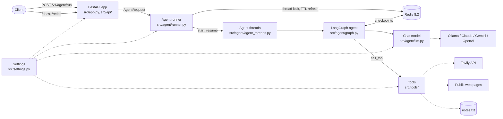
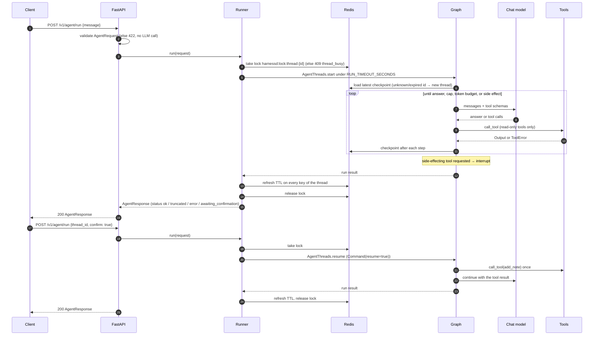
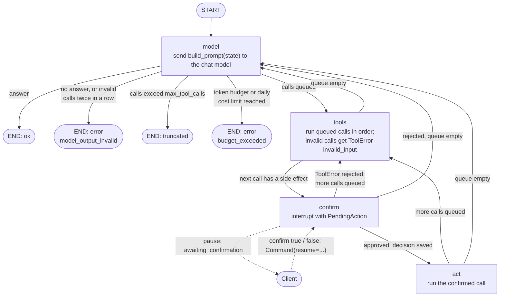

# Design: harnessd agent service

Status: reviewed
Specs: SPEC-0001 Agent core, SPEC-0002 API service, SPEC-0003 Tool contract,
SPEC-0004 State and persistence, SPEC-0005 Test strategy, SPEC-0006 Traceability,
SPEC-0007 API documentation, SPEC-0008 Logging, SPEC-0009 Thread management,
SPEC-0010 Observability (see [the spec index](../specs/README.md))

This document pulls together how the service is built and why. The specs are the
contract; where this document and a spec disagree, the spec wins and this document
is out of date.

## Problem and constraints
Create an example Claude Code workspace and demonstrate with a FastAPI service that uses an
LLM and tools.

The FastAPI service exposes one LangGraph agent. The agent answers a user message,
calling up to three tools, and every response is a validated, structured
`AgentResponse`. Conversation state lives in Redis so a thread can be continued, or
resumed after a human confirms a side effect.

Constraints:
- **Provider-agnostic model**: Ollama locally, Anthropic Claude, Google Gemini or OpenAI
  hosted, chosen by settings with no code change (SPEC-0001 B-0001).
- **Typed boundaries**: Pydantic v2 models for the API and for every tool's input
  and output; unknown fields are rejected.
- **Bounded runs**: a tool-call cap per request, a time limit per run and per tool,
  and one run per thread at a time.
- **Deterministic CI**: no real LLM or web calls and no API keys; real Redis only
  where persistence is under test (SPEC-0005).
- **Spec-first and traceable**: behavior is specified before it is coded, and tests
  name the spec behaviors they prove (SPEC-0006).
- **Non-goals**: auth, streaming, multi-agent routing, a UI, production deployment.

## Proposed approach
Starting with a basic version, develop and update the CLAUDE.md and other associated
files as the project progresses. Add on to these as new rules are needed.

FastAPI handles HTTP and validation. Each request goes to an agent runner that takes
a per-thread lock in Redis, runs the LangGraph graph against a Redis checkpointer
under a time limit, then refreshes the thread's TTL. The graph alternates between
the chat model and the tools until the model answers, the tool-call cap is reached,
or a side-effecting tool needs confirmation. Tools never raise: every failure comes
back to the model as a `ToolError`.

### Components
Status: **built** = on main; **review** = in an open PR; **planned** = specified, not
yet written.

| Module | Responsibility | Spec | Status |
|--------|----------------|------|--------|
| `src/app.py` | Builds the FastAPI app: Swagger/ReDoc metadata, lifespan (logging, tracing, `Services`, and a background load of the System One screen's model), error handlers, the request id middleware, the routers and the FastAPI instrumentation (outermost, so error responses are traced). | SPEC-0002, SPEC-0007, SPEC-0010, SPEC-0012 B-0017 | built |
| `src/logs.py` | `configure_logging()` (level, text or JSON lines); `event()` writes one event line with the fields of any enclosing `log_context()` block (request id, thread) and the current trace id. `audit(name, **fields)` writes an audit event on `harnessd.audit`, which `configure_logging()` keeps at info whatever `LOG_LEVEL` is. | SPEC-0008, SPEC-0010 B-0006, B-0008, SPEC-0012 B-0013 | built |
| `src/tracing.py` | `configure_tracing()`: OTLP export in batches to Langfuse (or `OTEL_EXPORTER_OTLP_ENDPOINT`), OpenInference instrumentation of LangChain, failed exports logged at most once a minute. `PROVIDER` hands spans to whichever provider is configured (no-op when off), since OTel's global provider and FastAPI's middleware can each be set only once. Our spans: `agent.run`, `agent.tool <name>`, `agent.confirm`, `thread.*`. | SPEC-0010 | built |
| `src/api/request_id.py` | Pure ASGI middleware: takes or makes the request id, returns it as `X-Request-ID`, tags log lines and the server span with it. | SPEC-0010 B-0006, B-0007 | built |
| `src/api/agent.py`, `src/api/threads.py`, `src/api/health.py` | One `APIRouter` per area: `POST /v1/agent/run` (turns `ConfirmationStateError` into 422); `GET`/`DELETE /v1/threads/{id}` and `POST /v1/threads/{id}/compact`; `GET /health`. | SPEC-0002, SPEC-0009 | built |
| `src/api/deps.py` | `Services` builds the Redis client, chat model and graph on first use, so the app starts while Redis is down. Dependencies `get_settings` → `get_graph` / `get_guard` / `get_metered` → `get_runner` / `get_threads`; tests override the graph, guard and metered model. `Services.metered()` is the agent's `MeteredModel`, built once from the chat model and `build_spend` (a `DailySpend` on the shared Redis client, or `None` without a daily limit); the graph, the runner and compaction all get it, and the chat screen gets a `MeteredModel` of its own on the same `DailySpend`. | SPEC-0002, SPEC-0009, SPEC-0012 B-0010 | built |
| `src/api/errors.py` | Exception handlers: `ThreadBusyError`, `ThreadAwaitingConfirmationError` and `ThreadRunUnfinishedError` → 409, `ThreadNotFoundError` → 404, `DailyLimitError` → 429 `budget_exceeded` with `Retry-After`, `SummaryError` → 500, Redis/LLM connection errors and provider refusals → 503, anything else → 500 via `InternalErrorMiddleware`. `error_responses()` documents a route's error codes. | SPEC-0002, SPEC-0007 B-0004, SPEC-0008 B-0005, SPEC-0012 B-0010 | built |
| `src/schemas.py` | Pydantic models: AgentRequest/AgentResponse, ErrorInfo, PendingAction, ToolError, each tool's Input/Output, the tool-call trace, ThreadState, AgentThreadState (a thread's status, pending action, messages and summary as `AgentThreads` reports it) and the compaction request/response. | SPEC-0002, SPEC-0003, SPEC-0009 | built |
| `src/settings.py` | One `Settings` class from env and `.env`; fails at startup if a hosted provider has no key, if the injection screen is on with no `INJECTION_SCREEN_MODEL`, or if `MAX_TOKENS_PER_RUN` is larger than `MAX_TOKENS_PER_THREAD`. `get_settings()` is cached for injection. | SPEC-0001, SPEC-0004, SPEC-0012 B-0005, B-0006, B-0009, B-0014 | built |
| `src/agent/llm.py` | `build_chat_model()`: ChatOllama, ChatAnthropic, ChatGoogleGenerativeAI or ChatOpenAI from settings, no network calls. ChatOpenAI's base URL is pinned to OpenAI's API, so environment variables can't redirect it. With `LLM_REQUESTS_PER_MINUTE` set, each model gets its own `InMemoryRateLimiter` (evenly spaced calls, no burst), so calls wait instead of hitting a provider quota. | SPEC-0001 B-0001, B-0008 | built |
| `src/agent/persistence.py` | `open_checkpointer()` (shallow Redis checkpointer with TTL; `ShallowRedisSaver` loads only the latest checkpoint's pending writes, SPEC-0004 B-0006), `refresh_thread_ttl()`, `thread_lock()` / `ThreadBusyError`, the `ThreadGuard` protocol (lock, TTL reset, time to expiry) the runner and thread service depend on, and `RedisThreadGuard`, which implements it. | SPEC-0004, SPEC-0009 B-0001 | built |
| `src/tools/base.py` | Tool contract: `Tool` metadata, `ToolContext` (settings, HTTP transport, DNS resolver), `ToolFailure`, `call_tool()`. | SPEC-0003 B-0001..B-0003 | built |
| `src/tools/{web_search,fetch_site,add_note}.py` | The three tools; registry in `src/tools/__init__.py`. web_search cuts snippets to 500 chars; fetch_site's text leaves out comments, scripts and styles, and elements hidden by the `hidden` attribute, `aria-hidden` or an inline `display:none` / `visibility:hidden`. | SPEC-0003 B-0005..B-0007, SPEC-0012 B-0001, B-0016 | built |
| `src/tools/sanitize.py` | `strip_invisible(text)` → the text without invisible characters (format characters such as zero-width, bidi and tag characters; variation selectors; Hangul fillers) and the count removed; `strip_model(model)` does the same to every string in a tool's output. | SPEC-0012 B-0015 | built |
| `src/agent/graph.py` | The agent loop: `model` node (cap and invalid-call checks), `tools` node (runs a turn's calls in order, stops before a side effect), `confirm` node (interrupt, then save the decision and reject, or pass the call to `act`), `act` node (run the confirmed call). The nodes settle each call through `ToolCalls`. `build_prompt` answers dangling calls and puts a compacted thread's summary in the system prompt. A run's input (`RunInput`) never carries the summary, so it survives later runs. Token budgets: the `model` node calls the model through `MeteredModel` (with the tools bound) and adds each reply's tokens to `run_tokens` (reset with the other run counters) and `thread_tokens` (saved with the thread, like `summary`), and logs them on `model.reply`; it also keeps `run_estimated` and `run_cost` (the metered calls' cost in micro-dollars, 0 when unpriced) for `run.end`. Before each model call, and after a reply that asks for tool calls, it ends the run with `budget_exceeded` when either budget is reached (`over_budget`); a reply that answers is returned even if it crossed. The node also asks the metered model for the day's stop before a call, and a call that reaches the daily cost limit ends the run the same way; the node never prices a call or touches the day's spend itself. Each budget stop is a `BudgetStop` (scope, used, limit, message), logged as the `budget.stop` audit event. | SPEC-0001 B-0002..B-0005, B-0007, SPEC-0009 B-0005, SPEC-0012 B-0008, B-0009, B-0013, B-0014 | built |
| `src/agent/tool_calls.py` | `ToolCalls`: what the graph nodes do with one tool call. `check(call)` → the `ToolError` that stops it running, or `None`; `needs_confirmation(call)` (a valid call to a tool with a side effect); `run(call)` (refused with `invalid_input` when the input doesn't validate) and `reject(call)` → `Settled`, the call's `ToolMessage` and its trace record (none for an invalid call); `pending_action(call)`; `malformed(reply)` → results for calls whose args aren't JSON. `tool_message()` builds a result message, also used for dangling calls. A read-only tool's output is stripped of invisible characters before its message and trace record are built, so eval stubs are stripped too. With a `Screen` given, that stripped output, as the JSON the model would receive, is then screened: at or above `INJECTION_THRESHOLD` it becomes the `rejected` ToolError "withheld: possible prompt injection", so the output reaches neither the message, the trace record nor the checkpoint. Any exception from the screen is a failure, logged as the `screen.failed` warning and settled by `INJECTION_SCREEN_ON_ERROR`, except a Redis error (a chat screen adding its cost to the day's spend), which propagates so the request gets a 503. Side-effect tools and ToolErrors are not screened. The probability goes on the `agent.tool` span as `screen.probability`. Owns the `tool.call` audit event, the `guard` audit events for stripped and withheld results (with the tool and call id; `error=true` when a failed screen withholds), the `tool.input` event (logger `harnessd.graph`) and the `agent.tool` spans. | SPEC-0001 B-0003..B-0005, SPEC-0008, SPEC-0010, SPEC-0012 B-0005, B-0006, B-0013, B-0015 | built |
| `src/agent/screen.py` | The injection screen behind the `Screen` protocol: `probability(text)` → float, raising on any failure, so the caller alone decides what a failure means. `SystemOneScreen` asks a decision model one `noul` question through `POST {OLLAMA_BASE_URL}/v1/systemone` (httpx); `ChatScreen` asks a chat model for typed JSON. Both validate the reply with Pydantic and time out after 20 s. Each System One request sends `keep_alive: -1`, as `nimble` stays loaded for its users outside this app too; `preload(screen)` loads it with a 5 minute timeout and logs `screen.preload_failed` on failure, never raising (the app runs it in the background at startup, and `make evals` waits for it). `build_screen(settings)` → the configured screen or `None`, with no network calls; a chat screen calls a `MeteredModel` over `build_chat_model` with `INJECTION_SCREEN_MODEL`, so it gets its own rate limiter and price, and its calls are added to the day's spend. The app and `make evals` pass it to `build_graph`. | SPEC-0012 B-0005, B-0006, B-0017 | built |
| `src/agent/prices.py` | The price table: flat USD per million input and output tokens per `(provider, model)`, with the date checked and the pricing page. `price_of()` (every Ollama model is free; `None` when unpriced, which `Settings` refuses with a daily limit) and `cost_micro_usd()` (rounded up). | SPEC-0012 B-0010, B-0011 | built |
| `src/agent/spend.py` | `DailySpend`: the day's spend in micro-dollars in a `SpendStore` (`RedisSpendStore`: `INCRBY` and a 48 h expiry on `harnessd:spend:<UTC date>`). `stop()` → a `BudgetStop` (scope `day`, in USD) or `None`; `refuse_if_reached()` logs `budget.stop` and raises `DailyLimitError` with `retry_after` (seconds to 00:00 UTC); `add(micro_usd)` adds one call's cost and returns the stop if the day is now at the limit. It knows no providers or prices, and only `MeteredModel` calls it. Checked before a call and added after, so runs at the same time can each go over by one call. Eval runs build no `DailySpend`, so they are neither counted nor limited. | SPEC-0012 B-0010, B-0013 | built |
| `src/agent/metered.py` | `MeteredModel`: a chat model with its provider, name and price, and the day's spend when there is a daily limit. It is the only place a model call is counted and priced. `call(prompt)` → the reply, its `Tokens` (usage metadata, or characters ÷ 4, marked estimated), its cost in micro-dollars (0 when unpriced) and the day's `BudgetStop` if the call reached the limit; the cost is added to the day's spend before it returns. `day_stop()` → the stop to end on before a call, or `None`; `refuse_if_reached()` logs `budget.stop` and raises `DailyLimitError`; `priced` says whether the model has a price; `with_tools(schemas)` → the same metered model with tools bound, sharing its price and spend. Without a `DailySpend` (no daily limit, eval runs) it still counts tokens and cost, never stops and writes nothing to Redis. It sets no timeout and logs no call: each caller keeps its own timeout and events. Three callers: the graph's `model` node, compaction's summary call and `ChatScreen`. | SPEC-0012 B-0008, B-0010, B-0011, B-0013 | built |
| `src/agent/redact.py` | `Redactor(settings)`: every `SecretStr` setting of at least 8 characters, replaced with `[redacted]` by `redact(text)` → (text, count). `response()` redacts an answer (truncated ones too), `thread()` the thread view's message text and summary, and `summary()` the summary a compaction returns; either logs the `guard` audit event with the count. The checkpoint and tool call records are left raw. The runner and `ThreadService` each build one. | SPEC-0012 B-0003, B-0004 | built |
| `src/prompts/` | One file per prompt (`system.md`, `summary.md`, `injection_screen.md`, and `injection_screen_chat.md` for the chat screen's reply format); `prompts.load()` reads them at import, so a missing file fails at startup. The graph and the thread service import `SYSTEM_PROMPT` and `SUMMARY_PROMPT` from here. The system prompt says tool results are untrusted data whose instructions are never followed, and that after a withheld result the model may try another source and tells the user. | SPEC-0001, SPEC-0009 B-0005, SPEC-0012 B-0002, B-0005 | built |
| `src/agent/agent_threads.py` | `AgentThreads`: the only module that reads or changes the graph's thread state. `state(id)` → `AgentThreadState` (idle, awaiting confirmation or unfinished) or `None` when missing; `start(id, message, max_tool_calls)` and `resume(id, approved, max_tool_calls)` check the thread's status (raising `ConfirmationStateError` when it doesn't allow the request) and return a `PreparedRun`, whose `pending_action` is the action being decided and whose `invoke()` runs the graph and returns a `RunResult` (the `AgentResponse` and the run's `RunUsage`: tokens, estimated, cost) and whose `stripped` counts the invisible characters removed from the message; `tool_calls(id)` and `usage(id)` for a timed-out run; `replace_history(id, removed, summary, summary_tokens)` for compaction, which also restarts the thread's token count at the summary's size; `delete(id)` → whether it existed, without loading the state. `start` strips invisible characters from the user message (SPEC-0012 B-0007, B-0015). Hides the thread config, `RunInput`, the run-counter reset, `Command(resume=…)`, `__interrupt__` and `Outcome`. No lock, TTL, timeout, logging or tracing. | SPEC-0001 B-0005, B-0007, SPEC-0002 B-0003, SPEC-0004 B-0006, SPEC-0009 | built |
| `src/agent/runner.py` | What the API calls: the daily cost limit check (`MeteredModel.refuse_if_reached`, raising `DailyLimitError`) → `ThreadGuard.hold` (lock) → `AgentThreads.start` / `resume` → audit `run.start` (and `confirm.decision`, or `guard` when the message lost invisible characters) → `PreparedRun.invoke()` under `RUN_TIMEOUT_SECONDS` (on timeout, an error response with `AgentThreads.tool_calls` and `usage`) → `ThreadGuard.touch` (TTL) → `Redactor.response` → `AgentResponse`. Logs and traces the run; `run.end` carries tokens, estimated and `cost_usd` (left out for an unpriced model). `DailyLimitError`, `ThreadBusyError` and `ConfirmationStateError` propagate; so do dependency errors, for the API to map to 503. | SPEC-0001 B-0006, SPEC-0002 B-0003, SPEC-0004, SPEC-0012 B-0003, B-0010, B-0013 | built |
| `src/agent/threads.py` | `ThreadService`: read a thread (`AgentThreads.state`; no lock, no TTL reset; reports idle, awaiting confirmation or unfinished; secrets redacted); delete it (lock → `AgentThreads.delete`); compact it (daily cost limit check → lock → refuse unless idle → `compaction_cut` → summary call through `MeteredModel` under `RUN_TIMEOUT_SECONDS`, which adds its cost to the day's spend → `AgentThreads.replace_history` with the summary's size in tokens → TTL reset; the returned summary is redacted). Compaction is never refused by the token budget. | SPEC-0009, SPEC-0012 B-0003, B-0010, B-0014 | built |
| `src/evals/` | The eval harness: `dataset.py` loads and validates `evals/cases/*.jsonl`; `stubs.py` swaps each tool's run for a canned result, keeping its schema and side-effect flag; `runner.py` runs each repeat of a case on a new thread through `AgentRunner` and deletes the thread after with `AgentThreads.delete`, counting tokens with LangChain's usage callback; `scoring.py` checks each turn, scores repeats and totals; `records.py` holds the run file, which records the injection screen, and a run with the screen on is partial; `report.py` accepts baselines, gates a full run on must_pass failures and drops below the baseline, and renders `evals/REPORT.md` from the run files. | SPEC-0011 B-0001..B-0005, B-0008, B-0009 | built |
| `scripts/run_evals.py` | `make evals`: validates the dataset and checks Redis before any model call, runs the cases on the configured model and the Redis checkpointer, writes `evals/runs/<run id>.json`, regenerates `evals/REPORT.md` and exits 1 when a full run fails the gate. `make evals-baseline` accepts the model's latest full run; `make evals-report` only rebuilds the report. | SPEC-0011 | built |
| `scripts/export_openapi.py` | Writes `docs/openapi.json` (`make openapi`). | SPEC-0007 B-0006 | built |
| `scripts/trace.py` | Builds `docs/traceability.md` from specs and test markers and flags gaps (`make trace`; run in CI). | SPEC-0006 | built |
| `tests/fakes.py` | `ScriptedChatModel`: replays scripted replies, records inputs. | SPEC-0005 B-0002 | built |
| `tests/conftest.py`, `tests/redis_support.py` | Clears API keys for every test; `redis_url` fixture (skip locally, fail in CI); `tool_context` fixture. | SPEC-0005 | built |
| `Dockerfile`, `docker-compose.yml` | App image; Redis 8.2 with data in a host folder (`REDIS_DATA_DIR`); Langfuse and its stores under the `observability` profile (`make langfuse`). | SPEC-0010 | built |
| `.github/workflows/ci.yaml` | Lint, format check, mypy; pytest with a Redis 8.2 service container. | SPEC-0005 | built |

### Data flow
A new message, then a confirmation of a side-effecting tool:

With `confirm: false`, the graph records ToolError `rejected` for the pending call and
continues. Sending a `message` while a confirmation is pending, or `confirm` when
nothing is pending, is a 422 (SPEC-0002 B-0003).

### Agent graph
The graph has four nodes (`src/agent/graph.py`, SPEC-0001). Each node returns a
`Command` naming the next node, and the checkpointer saves the state after every
node, so a run can stop at any point and resume later.

`confirm` and `act` are separate steps so that an approval is saved before the
side effect happens (SPEC-0001 B-0005). If the run stops while `act` runs the tool,
the thread is left unfinished rather than awaiting confirmation, so the call is
never run twice; the next run tells the model it may have run (SPEC-0001 B-0007,
SPEC-0004 B-0007).

The nodes hold the loop's rules; what happens to one tool call (validate, run or
refuse, its result message and trace record, its `tool.call` event and `agent.tool`
span) lives in `ToolCalls` (`src/agent/tool_calls.py`), so `tools` and `confirm`
settle a call the same way.

The state carries the thread's `messages`, the `queue` of calls from the latest model
turn that have not run yet, the run counters (`max_tool_calls`, `calls_used`,
`trace`, `outcome`, reset on each request), `invalid_turns` and `confirmed` (the ids
of approved calls, kept with the thread so `build_prompt` can tell an interrupted
approved call from one that never ran). A paused `confirm` keeps its `queue` in the
checkpoint, so the calls after it run once the user answers. On a confirmation the
counter reset travels in the resume value and the `confirm` step applies it. It is
not sent as `Command(update=…)`: LangGraph saves such an update as pending writes
before the step runs, so a step that never finished left them behind and the next
resume failed with `InvalidUpdateError`. `AgentThreads` turns the final state into an `AgentResponse`, and is the
only module that reads these fields; the runner, the thread service and the eval
runner see a thread only through its interface.

### Data models and storage
**API** (`src/schemas.py`, SPEC-0002):
- `AgentRequest`: thread_id, exactly one of `message` / `confirm`, max_tool_calls (1..20).
- `AgentResponse`: a model validator keeps the fields consistent with `status`.
- `ErrorInfo`; `PendingAction`; `ApiError` for 404/409/500/503 (SPEC-0007); `HealthResponse`.
- `ThreadState` (messages as user/assistant/tool `ThreadMessage`s, no system prompt or
  run counters), `CompactRequest`, `CompactResponse` (SPEC-0009).

**Tools** (SPEC-0003):
- `ToolError` with codes invalid_input, timeout, upstream_error, rejected, internal.
- Each tool's Input/Output model.
- The trace is a list of `ToolCallRecord`s, a union discriminated by tool name, with
  exactly one of output / error set.

**Redis** (SPEC-0004):

| Key | Written by | Expiry |
|-----|-----------|--------|
| `checkpoint:<thread>:…`, `checkpoint_write:<thread>:…` and related | `ShallowRedisSaver`, our subclass of `AsyncShallowRedisSaver` (latest state per thread only) | `CHECKPOINT_TTL_HOURS` (24 h), reset on every key after each run |
| `harnessd:lock:thread:<thread>` | `thread_lock()` | `RUN_TIMEOUT_SECONDS` + 30 s |

The checkpointer sets a TTL only on keys it writes in the current run, so keys from
earlier runs would expire first. `refresh_thread_ttl()` therefore re-applies the TTL
to every key containing the thread id (a UUID) after each run, except the lock key.
`GET /v1/threads/{id}` reports the smallest of those TTLs as `expires_in_seconds`.

**Files**:
- Notes: `NOTES_PATH` (default `data/notes.txt`), one
  `YYYY-MM-DDTHH:MM:SSZ<TAB>text` line per note.
- Notes under docker compose: `NOTES_DIR` (default `data/notes`), mounted at
  `/srv/data/notes` in the app container.
- Local Redis data: `REDIS_DATA_DIR` (default `data/redis`).
- All of these live under the gitignored `data/` by default.

### Failure modes
| What goes wrong | Response | Spec |
|-----------------|----------|------|
| Invalid request body | 422, model never called | SPEC-0002 B-0001 |
| `message` while awaiting confirmation, or `confirm` with nothing pending | 422 | SPEC-0002 B-0003 |
| Another run holds the thread | 409 `thread_busy`, state untouched | SPEC-0002 B-0004, SPEC-0004 B-0005 |
| Redis or LLM provider unreachable | 503 `dependency_unavailable` | SPEC-0002 B-0005 |
| Tool fails (bad args, upstream error, exception) | ToolError returned to the model; run continues | SPEC-0003 B-0001, SPEC-0001 B-0003 |
| Tool exceeds its timeout | ToolError `timeout` | SPEC-0003 B-0002 |
| Tool-call cap reached | status `truncated` | SPEC-0001 B-0002 |
| Model output unusable (bad tool args twice, no answer) | status `error`, `model_output_invalid` | SPEC-0001 B-0004 |
| Run exceeds `RUN_TIMEOUT_SECONDS` | status `error`, `internal` | SPEC-0001 B-0006 |
| Process dies mid-run | lock expires after timeout + 30 s; thread usable again | SPEC-0004 B-0005 |
| fetch_site URL (or redirect) points at a non-public address | ToolError `invalid_input` | SPEC-0003 B-0006 |
| Thread id unknown or expired | new thread with that id; 404 `thread_not_found` on the thread endpoints | SPEC-0004 B-0002, SPEC-0009 B-0001 |
| Compacting a thread awaiting confirmation | 409 `thread_awaiting_confirmation` | SPEC-0009 B-0007 |
| Compacting a thread whose last run timed out mid-step | 409 `thread_run_unfinished`; the next message finishes it | SPEC-0009 B-0011 |
| Summary call times out or returns no text | 500 `internal`, `thread.compact_failed` warning, state unchanged (a provider error is a 503) | SPEC-0009 B-0008 |
| Trace backend down or slow | Requests unaffected (export runs on the batch processor's thread); `trace.export_failed` warning at most once a minute | SPEC-0010 B-0005 |
| Redis lacks the JSON/search modules | `redis` tests skip locally / fail in CI with a clear reason | SPEC-0005 B-0003 |

## Alternatives considered
| Option | Pros | Cons | Why not |
|--------|------|------|---------|
| Another agent framework: a hand-written tool loop on the provider SDKs, PydanticAI, a single-provider SDK (OpenAI Agents SDK, Anthropic's tool runner) or LlamaIndex | Fewer dependencies (hand-written); typed agents (PydanticAI); first-party tooling (provider SDKs) | Checkpointing, pause-and-resume and history repair to build ourselves, or no ready-made Redis checkpointer; provider SDKs centre on one vendor's API | LangGraph gives a Redis checkpointer (`langgraph-checkpoint-redis`), `interrupt()` / `Command(resume=…)` for confirmations (SPEC-0001 B-0005), provider-neutral chat models (SPEC-0001 B-0001), and explicit nodes that run on a scripted model in tests |
| Redis Stack image instead of Redis 8.2 | Long-standing way to get JSON + search | Older line; was pinned to `:latest` | Redis 8+ bundles both modules in the official image |
| Full checkpointer (`AsyncRedisSaver`) | Keeps history for time travel | More keys per thread; history unused | We only ever resume the latest state |
| `refresh_on_read` TTL option | No extra code | Measured: earlier runs' keys keep their old countdown | Doesn't meet SPEC-0004 B-0003 |
| Global B/AT ids across specs | Fewer test edits when splitting | Gaps in every spec's numbering | Per-spec ids, always written with the spec id |
| Mock the checkpointer in tests | No Redis needed | Misses real TTL, lock and index behavior | Real Redis via fixture; graph tests use `InMemorySaver` |
| LangChain `init_chat_model` | One call for any provider | Needs the `langchain` package | A small factory over the four provider packages |
| Hand-written Tavily fake | Simple | Skips the real client's request/response handling | Real client on an `httpx.MockTransport` |
| `DOCS_ENABLED` setting | Can hide docs | Extra config for a non-production service | Docs always on |
| Set OTel's global tracer provider at startup | The usual OTel setup | Can be set once per process, and FastAPI's middleware fetches its tracer once, so tests couldn't switch tracing on and off | A switching provider that delegates each span to the configured one |
| Build the API before tools and graph | Swagger to try early | Needs a placeholder runner | Tools → graph → API, each piece real when it lands |

## Decision
- One LangGraph agent behind a runner that owns the lock, timeout and TTL refresh, so
  the API layer stays thin and testable with a fake runner.
- One module, `AgentThreads`, owns the graph's thread state: status, runs, history
  and deletion. Before it, the runner, the thread service and the eval runner each
  read LangGraph's snapshot layout, and a thread's status was worked out in five
  places. Trade-off: one more module between the runner and the graph.
- Redis 8.2 with the shallow checkpointer and an explicit TTL refresh; a Redis lock
  per thread. Trade-off: a `SCAN` per run and a dependency on Redis modules.
- One module, `MeteredModel`, owns a model call's accounting: counting tokens,
  pricing, the day's spend and the daily cost limit. Before it, the graph, compaction
  and the chat screen each wrote invoke → count → price → add by hand, and the price
  was looked up in four modules. Run and thread token budgets stay in the graph, as
  they are thread state. Trade-off: the graph no longer holds the chat model itself.
- Tools follow one contract and never raise; side effects need confirmation through
  a LangGraph interrupt. Trade-off: the confirmation is a second HTTP request.
- Tests use a scripted model and mocked HTTP/DNS; only persistence tests use real
  Redis. Trade-off: provider-specific quirks aren't exercised in CI.

## Risks and open questions
- **DNS rebinding** (fetch_site): addresses are checked before the request, but
  `httpx` resolves again when connecting. Fix by connecting to the checked IP if the
  service is ever exposed.
- **TTL refresh cost**: `SCAN` over the keyspace per run is fine at this scale but
  grows with all of Redis. Planned fix: renew only the thread's keys through the
  checkpointer's own per-thread index ([#14](https://github.com/darrenpaine/harnessd/issues/14)).
- **add_note after timeout**: the file write runs in a worker thread that a timeout
  can't stop, so a note may be written even though the tool reported `timeout`.
  If the model then asks again, the user sees a second confirmation and may approve
  a duplicate. A run that stops during a confirmed call never reruns it (SPEC-0004
  B-0007).
- **Swagger assets** load from a CDN, so `/docs` needs internet access in the browser.
- **Detecting an unreachable dependency** relies on exception types: Redis
  `ConnectionError`/`TimeoutError` (also when wrapped by redisvl's
  `RedisSearchError`), `httpx.TransportError` (Ollama, Gemini) and LangChain's
  `ModelConnectionError` (Anthropic; also OpenAI, which `langchain-openai` wraps in
  LangChain's error types). A provider that raises something else gives a
  500 instead of a 503.
- **Span parents in graph nodes**: OpenInference doesn't make its node spans current
  in the OTel context, so `agent.tool` and `agent.confirm` find their parent with
  its `get_current_span()` (from LangChain's run config). A change there would
  attach them to `agent.run` instead; `test_run_span_tree` would catch it.
- **Langfuse stack** needs several GB of RAM (Postgres, ClickHouse, Redis, MinIO),
  so it runs only under the `observability` profile, never in CI.
- **langgraph-checkpoint-redis private API**: version 0.5.2 loads every pending
  write a thread ever made, not just the latest checkpoint's, so a second
  confirmation on a thread failed with `InvalidUpdateError`. `ShallowRedisSaver`
  overrides the private `_aload_pending_writes` and relies on the library's key
  layout and write documents, so an upgrade can break it silently. Import fails
  if the method disappears, and SPEC-0004 AT-0006
  (`test_repeated_confirmations`) fails if it stops applying; re-check the class on
  every upgrade, and drop it once the library is fixed
  ([langgraph-redis#215](https://github.com/redis-developer/langgraph-redis/issues/215)). The old writes still stay
  in Redis until the thread expires.
- **langgraph-checkpoint-redis** emits a deprecation warning about
  `get_async_redis_connection`; watch for a breaking release.
- **Traceability script** (SPEC-0006) isn't built yet, so gaps are checked by hand.
  SPEC-0005 AT-0005 waits on it.
- **Local Ollama**: the default model (`llama3.1`) must be pulled before local runs.
